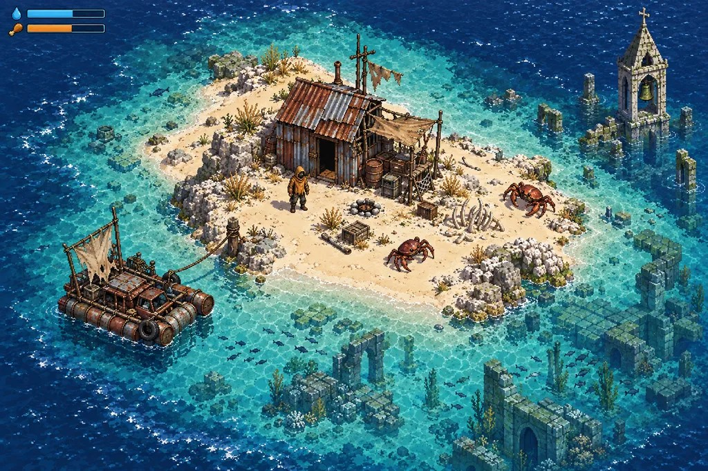

# GPverse — Mare Alto

**Versione: V0.0.2** — concept, ancora niente di giocabile.

Mare Alto è un survival open world senza storia prefissata. Scegli un sopravvissuto in un'Italia sommersa e ridisegnata, 400 anni nel futuro, e fai quello che vuoi: navigare, commerciare, esplorare le città sommerse, fondare un villaggio o comandare una flotta.

## Il mondo in breve

- Il mare è salito di circa 150 m (l'Onda Lunga) e secoli di terremoti e vulcani (le Grandi Fratture) hanno ridisegnato la mappa.
- Zone di gioco: mare aperto, atolli adattati, Terre Alte (Alpi e Appennino), fratture vulcaniche, rovine sommerse.
- Tono alla Mad Max: il carburante è potere, i mezzi sono di recupero e l'economia è di baratto.
- Le fazioni sono Bruciatori, Signori delle Terre Alte, Flottiglie, Palombari e Figli dell'Onda.

Il documento di design completo è su Claude: *GPverse — Mare Alto · Game Design Document*.

## Stile grafico

È pixel art 2D dettagliata, con vista dall'alto a 3/4 (vedi `docs/STILE.md`).

## Versionamento

Formato **V.maior.minor.patch**, con la versione sempre visibile nel titolo e nella schermata iniziale. Le modifiche sono registrate in `CHANGELOG.md`.
